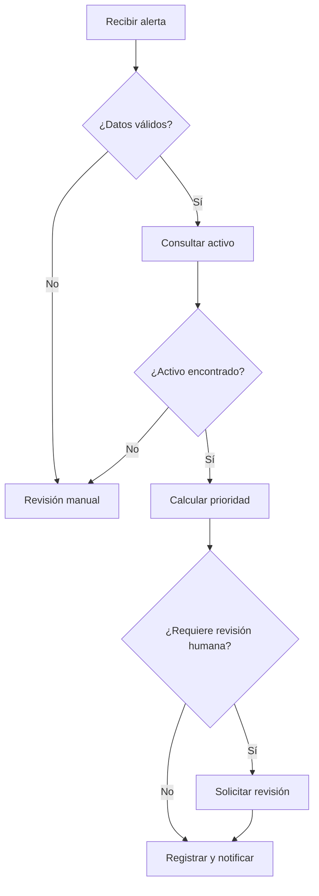

# Laboratorio 1 — Diseño de una automatización técnica

## Contexto

En este primer laboratorio no vamos a construir todavía un workflow en n8n ni un agente en Dify. Antes de automatizar un proceso, necesitamos comprobar que el proceso está suficientemente definido, que sus entradas y decisiones pueden describirse con claridad y que sabemos dónde debe mantenerse la intervención humana.

El objetivo es trabajar como lo haría un equipo técnico antes de implementar una automatización real: analizar varios procesos candidatos, seleccionar uno, modelar su flujo y revisar los riesgos de automatizarlo.

El caso que utilizaremos durante el resto del curso será el **triaje de alertas técnicas de infraestructura**. En módulos posteriores este mismo caso evolucionará progresivamente hasta convertirse en una solución integrada con n8n, webhooks, APIs, Dify, RAG, controles de seguridad y aprobación humana.

> **Importante:** todos los datos del laboratorio son ficticios. No utilices información productiva, credenciales reales ni datos sensibles.

---

## Objetivos de aprendizaje

Al terminar el laboratorio deberías ser capaz de:

- Identificar procesos técnicos que son buenos candidatos a automatización.
- Distinguir entre tareas deterministas y tareas que podrían beneficiarse de IA.
- Separar un proceso en entrada, validación, enriquecimiento, decisión y salida.
- Identificar reglas de negocio, excepciones y datos obligatorios.
- Evaluar riesgo, impacto y reversibilidad antes de automatizar.
- Determinar qué decisiones pueden automatizarse y cuáles requieren supervisión humana.
- Definir criterios de aceptación antes de construir el workflow.

---

## Material proporcionado

Dentro de la carpeta `materiales/` encontrarás:

- `casos_candidatos.csv`: seis procesos técnicos ficticios que podrían automatizarse.
- `alertas_ejemplo.json`: ejemplos de alertas que recibirá el proceso seleccionado.
- `catalogo_activos.csv`: catálogo ficticio de activos que permite enriquecer las alertas.
- `plantilla_entrega.md`: plantilla que debes completar durante el laboratorio.

No necesitas instalar ninguna herramienta adicional. Puedes editar la plantilla con cualquier editor de Markdown.

---

# Parte 1 — Identificar procesos candidatos

Abre `materiales/casos_candidatos.csv`.

Encontrarás seis procesos técnicos diferentes. Para cada uno, analiza al menos los siguientes aspectos:

1. **Frecuencia**: ¿ocurre de manera suficientemente repetitiva como para justificar una automatización?
2. **Estructura de la entrada**: ¿la información llega en campos claros o en texto ambiguo?
3. **Reglas**: ¿las decisiones pueden expresarse mediante reglas conocidas?
4. **Integraciones**: ¿necesitamos consultar otros sistemas o ejecutar acciones externas?
5. **Impacto del error**: ¿qué ocurriría si la automatización toma una decisión incorrecta?
6. **Reversibilidad**: ¿una acción incorrecta puede deshacerse fácilmente?
7. **Necesidad de IA**: ¿el problema puede resolverse con lógica determinista o necesita interpretar texto/contexto?
8. **Supervisión humana**: ¿hay alguna decisión que no debería ejecutarse automáticamente?

Utiliza una escala sencilla de 1 a 3 en la plantilla:

- **1 = favorable / bajo**
- **2 = intermedio**
- **3 = desfavorable / alto**

Para los criterios positivos —por ejemplo, repetitividad o estructura— puedes anotar adicionalmente si el valor es **alto, medio o bajo**. Lo importante no es obtener una puntuación matemática perfecta, sino justificar la decisión.

## Preguntas de reflexión

Antes de continuar, responde:

- ¿Qué proceso parece más fácil de automatizar?
- ¿Cuál podría aportar más valor?
- ¿Cuál presenta mayor riesgo?
- ¿En cuál utilizarías una automatización determinista?
- ¿En cuál tendría sentido introducir IA?
- ¿Qué proceso no automatizarías de extremo a extremo?

---

# Parte 2 — Seleccionar el caso de trabajo

Después de comparar los candidatos, selecciona el que consideres más adecuado para un primer prototipo.

Debes justificar la selección teniendo en cuenta:

- valor esperado;
- complejidad;
- calidad de las entradas;
- riesgo;
- posibilidad de probarlo sin afectar a sistemas reales;
- capacidad de mantener control humano.

## Caso común para el resto del curso

Independientemente del proceso que hayas elegido en tu análisis inicial, a partir de este punto todos trabajaremos con:

> **CASO-01 — Triaje y enriquecimiento de alertas técnicas de infraestructura**

Esto permite que en los módulos siguientes todos partamos de los mismos datos y podamos evolucionar el mismo prototipo.

---

# Parte 3 — Comprender el proceso actual

El proceso manual actual es el siguiente:

1. Una plataforma de monitorización genera una alerta.
2. Un operador revisa que la alerta tenga los datos mínimos necesarios.
3. El operador consulta el catálogo de activos para identificar:
   - entorno;
   - criticidad del activo;
   - equipo responsable.
4. El operador combina la severidad de la alerta con la criticidad del activo.
5. Determina una prioridad operativa.
6. Decide si la alerta puede continuar automáticamente o si necesita revisión humana.
7. Registra el resultado del análisis.
8. Escala el caso al equipo responsable cuando procede.

En este laboratorio **no ejecutaremos ninguna remediación automática**.

La automatización que diseñes debe limitarse a:

- validar;
- enriquecer;
- clasificar;
- recomendar;
- registrar;
- escalar.

---

# Parte 4 — Analizar las entradas

Abre `materiales/alertas_ejemplo.json`.

Identifica:

- qué campos aparecen en todas las alertas;
- qué campos deberían ser obligatorios;
- qué campos pueden ser opcionales;
- qué valores parecen pertenecer a un conjunto cerrado;
- qué alertas contienen datos incompletos o problemáticos.

Como mínimo, considera obligatorios para el prototipo:

- `alert_id`
- `timestamp`
- `asset_id`
- `severity`
- `summary`

## Preguntas

- ¿Qué debería ocurrir si falta `asset_id`?
- ¿Qué debería ocurrir si `severity` contiene un valor desconocido?
- ¿Deberíamos continuar si no encontramos el activo en el catálogo?
- ¿Es correcto asignar prioridad únicamente con la severidad de la alerta?

Documenta tus respuestas en la plantilla.

---

# Parte 5 — Enriquecer la alerta

Abre `materiales/catalogo_activos.csv`.

El catálogo contiene información adicional sobre los activos:

- `asset_id`
- `asset_name`
- `environment`
- `criticality`
- `owner_team`

Relaciona manualmente cada alerta válida con su activo.

Ejemplo conceptual:

```text
Alerta
  asset_id = srv-web-01
        |
        v
Catálogo de activos
  environment = production
  criticality = high
  owner_team = WebOps
```

## Preguntas

- ¿Por qué es útil separar los datos de la alerta de los datos del activo?
- ¿Qué ventaja tendrá consultar este catálogo mediante una API en lugar de copiar todos los datos dentro del workflow?
- ¿Qué riesgo aparece si el catálogo contiene información obsoleta?

---

# Parte 6 — Diseñar las reglas de prioridad

Para este prototipo utilizaremos las siguientes reglas iniciales.

## Prioridad P1

Asignar `P1` cuando:

- la severidad sea `critical`; o
- la severidad sea `high`, el activo esté en `production` y su criticidad sea `high`.

## Prioridad P2

Asignar `P2` cuando:

- la severidad sea `high` y no se cumplan las condiciones de P1.

## Prioridad P3

Asignar `P3` cuando:

- la severidad sea `medium`.

## Prioridad P4

Asignar `P4` cuando:

- la severidad sea `low`.

## Excepciones

La alerta debe desviarse a revisión manual cuando:

- falte un campo obligatorio;
- el activo no exista en el catálogo;
- la severidad no sea uno de estos valores: `low`, `medium`, `high`, `critical`;
- los datos sean contradictorios o no permitan aplicar las reglas con seguridad.

Construye una tabla de decisión en tu entrega.

---

# Parte 7 — Definir la intervención humana

No todas las fases tienen el mismo riesgo.

Para este laboratorio utilizaremos cuatro niveles:

- **H0 — Automático:** puede ejecutarse sin revisión humana.
- **H1 — Revisión posterior:** la automatización puede actuar, pero el resultado queda disponible para auditoría o revisión.
- **H2 — Aprobación previa:** la automatización propone una acción, pero una persona debe aprobarla antes de ejecutarla.
- **H3 — Ejecución manual:** la automatización solo aporta información; la acción final debe realizarla una persona.

Asigna un nivel a cada una de estas actividades:

- validar campos;
- consultar datos del activo;
- calcular prioridad;
- generar una recomendación;
- registrar evidencias;
- notificar al equipo responsable;
- reiniciar un servidor;
- bloquear una cuenta;
- modificar una regla de firewall.

Justifica especialmente las actividades H2 y H3.

---

# Parte 8 — Modelar el workflow

Diseña un flujo con al menos estas etapas:

```text
ENTRADA
   |
   v
VALIDACIÓN
   |
   +---- error ----> REVISIÓN MANUAL
   |
   v
ENRIQUECIMIENTO
   |
   +---- activo no encontrado ----> REVISIÓN MANUAL
   |
   v
CLASIFICACIÓN
   |
   v
DECISIÓN
   |
   +---- P1 / caso sensible ----> REVISIÓN HUMANA
   |
   v
REGISTRO + NOTIFICACIÓN
```

Puedes representarlo con texto, Mermaid o un diagrama realizado con otra herramienta, pero la lógica debe quedar inequívocamente descrita.

Si utilizas Mermaid, puedes partir de esta estructura y completarla:



---

# Parte 9 — Evaluar riesgos

Evalúa al menos estos riesgos:

- entrada incompleta;
- severidad incorrecta;
- activo inexistente;
- catálogo desactualizado;
- clasificación incorrecta;
- notificación al equipo equivocado;
- automatización de una acción destructiva;
- pérdida de trazabilidad;
- exposición de datos sensibles;
- dependencia futura de una respuesta de IA no verificada.

Para cada riesgo indica:

- probabilidad: baja / media / alta;
- impacto: bajo / medio / alto;
- control propuesto;
- nivel de intervención humana necesario.

---

# Parte 10 — Definir criterios de aceptación

Antes de construir un workflow hay que definir cómo sabremos que funciona correctamente.

Define al menos ocho criterios de aceptación.

Ejemplos de formato:

```text
CA-01: Si falta asset_id, el caso no debe continuar al enriquecimiento.
CA-02: Una alerta critical debe clasificarse como P1.
```

Incluye criterios para:

- entradas válidas;
- entradas incompletas;
- activo desconocido;
- cada nivel de severidad;
- trazabilidad;
- revisión humana.

---

# Entrega

Completa `materiales/plantilla_entrega.md`.

Tu documento final debe incluir:

1. comparación de procesos candidatos;
2. justificación de la selección;
3. descripción del proceso actual;
4. entradas y campos obligatorios;
5. tabla de decisión;
6. mapa del workflow;
7. puntos de intervención humana;
8. matriz de riesgos;
9. criterios de aceptación;
10. conclusión: qué automatizarías ahora y qué dejarías fuera del primer prototipo.

---

# Comprobación final

Antes de dar el laboratorio por terminado, deberías poder responder claramente a estas preguntas:

- ¿Qué problema resuelve la automatización?
- ¿Cuál es su entrada exacta?
- ¿Qué datos necesita de otros sistemas?
- ¿Qué reglas son deterministas?
- ¿Qué situaciones deben interrumpir el flujo?
- ¿Qué acciones necesitan una persona?
- ¿Qué resultado genera el proceso?
- ¿Cómo podremos comprobar posteriormente que la automatización tomó la decisión correcta?

Si alguna respuesta sigue siendo ambigua, todavía no estamos preparados para construir el workflow.

---

## Qué ocurrirá en el siguiente laboratorio

En el siguiente módulo trasladaremos este diseño a **n8n**. Empezaremos con una ejecución controlada y datos estructurados, implementaremos validaciones y rutas alternativas, y revisaremos el historial de ejecución para comprobar la trazabilidad del flujo.
