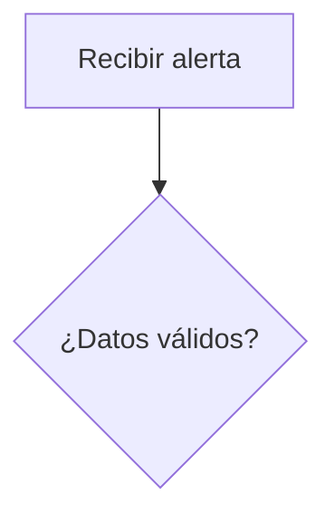

# Entrega — Laboratorio 1: Diseño de una automatización técnica

**Nombre:**  
**Fecha:**  

---

## 1. Comparación de procesos candidatos

| Caso | Repetitividad | Entrada estructurada | Reglas claras | Complejidad de integración | Impacto del error | Reversibilidad | ¿IA necesaria? | Supervisión humana | Valoración global |
|---|---|---|---|---|---|---|---|---|---|
| CASO-01 | | | | | | | | | |
| CASO-02 | | | | | | | | | |
| CASO-03 | | | | | | | | | |
| CASO-04 | | | | | | | | | |
| CASO-05 | | | | | | | | | |
| CASO-06 | | | | | | | | | |

### Reflexión

**Proceso más fácil de automatizar:**  

**Proceso con mayor valor potencial:**  

**Proceso con mayor riesgo:**  

**Proceso que resolvería principalmente con reglas deterministas:**  

**Proceso donde introduciría IA:**  

**Proceso que no automatizaría de extremo a extremo:**  

---

## 2. Selección inicial

**Caso seleccionado:**  

**Justificación:**  

---

## 3. Caso común del curso: CASO-01

### 3.1 Problema actual

Describe el problema operativo que queremos resolver.

### 3.2 Resultado esperado

Describe qué debería producir el prototipo sin ejecutar todavía acciones de remediación.

### 3.3 Actor o sistema que inicia el proceso

### 3.4 Sistemas implicados

---

## 4. Análisis de entradas

### 4.1 Campos identificados

| Campo | Obligatorio | Tipo esperado | Valores permitidos / ejemplo | Qué hacer si falta o es inválido |
|---|---|---|---|---|
| alert_id | | | | |
| timestamp | | | | |
| asset_id | | | | |
| severity | | | | |
| source | | | | |
| category | | | | |
| summary | | | | |
| details | | | | |

### 4.2 Casos problemáticos detectados en `alertas_ejemplo.json`

| Alert ID | Problema | ¿Debe continuar? | Tratamiento propuesto |
|---|---|---|---|
| | | | |

---

## 5. Enriquecimiento con catálogo de activos

### 5.1 Datos añadidos

| Campo enriquecido | Fuente | Para qué se utiliza |
|---|---|---|
| environment | | |
| criticality | | |
| owner_team | | |

### 5.2 Resultado del enriquecimiento manual

| Alert ID | Asset encontrado | Environment | Criticality | Owner team |
|---|---|---|---|---|
| ALT-1001 | | | | |
| ALT-1002 | | | | |
| ALT-1003 | | | | |
| ALT-1004 | | | | |
| ALT-1005 | | | | |
| ALT-1006 | | | | |

---

## 6. Tabla de decisión de prioridad

| Condición | Resultado | Justificación |
|---|---|---|
| severity = critical | | |
| severity = high AND environment = production AND criticality = high | | |
| severity = high y no cumple P1 | | |
| severity = medium | | |
| severity = low | | |
| severity desconocida | | |
| asset no encontrado | | |
| falta campo obligatorio | | |

### Resultado esperado para las alertas válidas

| Alert ID | Priority / estado | Motivo |
|---|---|---|
| ALT-1001 | | |
| ALT-1002 | | |
| ALT-1003 | | |
| ALT-1004 | | |
| ALT-1005 | | |
| ALT-1006 | | |

---

## 7. Intervención humana

| Actividad | H0 / H1 / H2 / H3 | Justificación |
|---|---|---|
| Validar campos | | |
| Consultar datos del activo | | |
| Calcular prioridad | | |
| Generar recomendación | | |
| Registrar evidencias | | |
| Notificar al equipo responsable | | |
| Reiniciar un servidor | | |
| Bloquear una cuenta | | |
| Modificar una regla de firewall | | |

---

## 8. Mapa del workflow

Incluye aquí tu diagrama o descripción paso a paso.

---

## 9. Matriz de riesgos

| Riesgo | Probabilidad | Impacto | Control propuesto | Intervención humana |
|---|---|---|---|---|
| Entrada incompleta | | | | |
| Severidad incorrecta | | | | |
| Activo inexistente | | | | |
| Catálogo desactualizado | | | | |
| Clasificación incorrecta | | | | |
| Notificación incorrecta | | | | |
| Acción destructiva automática | | | | |
| Pérdida de trazabilidad | | | | |
| Exposición de datos sensibles | | | | |
| Respuesta de IA no verificada | | | | |

---

## 10. Criterios de aceptación

- **CA-01:**
- **CA-02:**
- **CA-03:**
- **CA-04:**
- **CA-05:**
- **CA-06:**
- **CA-07:**
- **CA-08:**

---

## 11. Alcance del primer prototipo

### Automatizaría ahora

### Mantendría fuera del prototipo

### Requeriría aprobación humana

---

## 12. Conclusiones

Resume qué has aprendido sobre la diferencia entre automatizar un proceso y simplemente trasladar un proceso manual a una herramienta visual.
